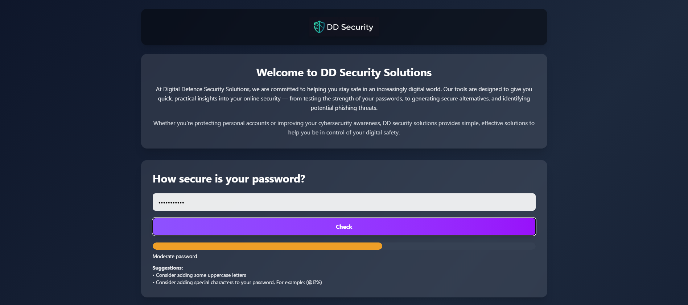
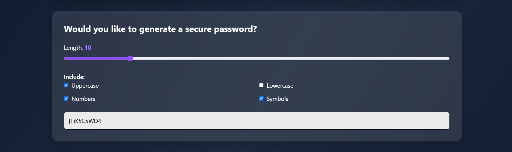
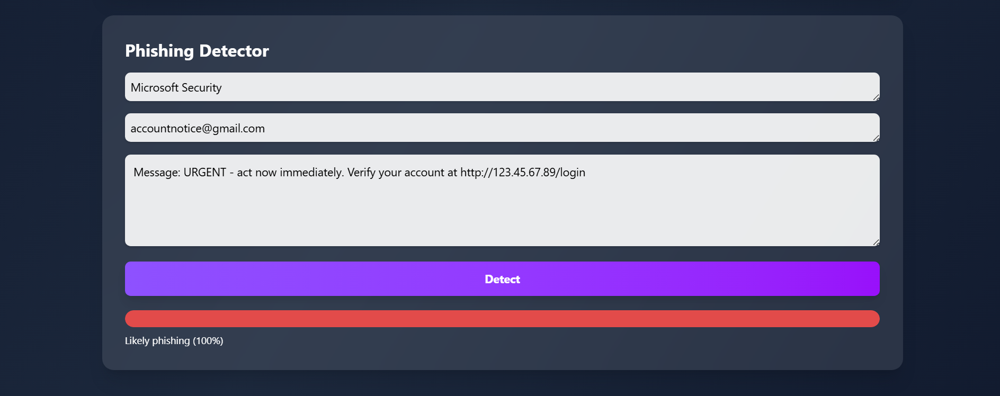
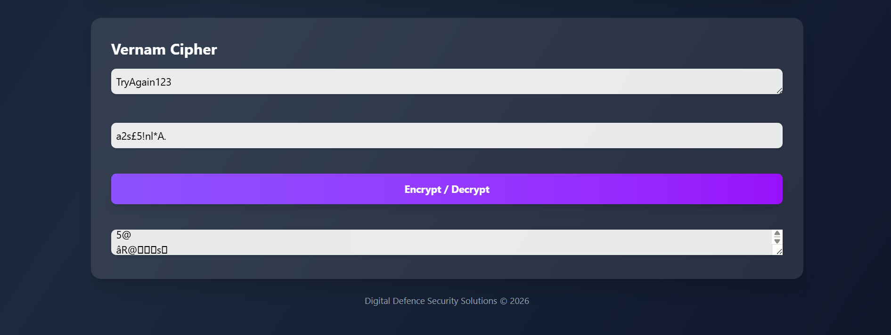

# DD Security Solutions

DD Security Solutions is a browser-based online safety project created for a six-person university group assignment. The site combines several small cybersecurity tools, including password checking, password generation, a rule-based phishing checker and a Vernam/XOR cipher demonstration.

**HTML · JavaScript · Tailwind CSS**

## Project screenshots

<p align="center">
  
  
</p>

<p align="center">
  
  
</p>

The password tools check common password characteristics and generate passwords from selected character types. The phishing example above uses deliberately suspicious test input to demonstrate the rules the checker looks for; its percentage is a heuristic score rather than a real probability.

## Why we built it

The assignment was based around online safety and cybersecurity awareness. As a group, we combined several interactive tools into one website so users could experiment with password strength, password generation, phishing indicators and simple encryption.

## My contribution

This was a six-person team project.

I assisted with debugging and some of the password-tool work, but my main responsibility was the **Vernam cipher feature**. I implemented the XOR-based cipher logic and built the HTML interface for it, allowing a user to enter a message and a same-length key and then encrypt or decrypt the result.

The encryption logic itself was relatively straightforward. The more time-consuming part was designing and integrating the HTML section so that it matched the rest of the site and worked cleanly alongside the other tools.

## Main functionality

- password-strength feedback using length and character-type checks
- configurable password generation
- rule-based phishing indicators using sender details and suspicious message patterns
- Vernam/XOR encryption and decryption demonstration
- browser-based interface styled with Tailwind CSS

## What I learned

The project gave me practical experience with the technologies I was implementing rather than only learning them in isolation. In particular, I became more comfortable with:

- structuring interactive interfaces with HTML
- connecting HTML elements to JavaScript
- handling user input and DOM elements
- debugging front-end behaviour
- using regular expressions and simple rule-based checks
- implementing XOR-based encryption logic
- integrating my work with code written by other members of a team

## How to run it

No build step is required. From the project folder, run:

```bash
python -m http.server 8000
```

Then open:

```text
http://localhost:8000
```

The page uses Tailwind CSS through a browser CDN, so an internet connection is needed for the styling to load correctly.

## Current limitations

This is a university project rather than a production security tool.

The phishing checker uses a small set of rules and its percentage is only a score based on matched indicators. It can produce false positives and false negatives.

The password generator uses `Math.random()`, and the original implementation falls back to the full character set if every character-type option is deselected.

The Vernam section demonstrates XOR on character codes for learning purposes; its output can therefore include non-printable-looking characters.

## Possible next steps

- improve password-generator validation
- use a cryptographically secure random source for generated passwords
- improve the phishing-checking rules
- improve mobile responsiveness and accessibility
- add automated browser tests
